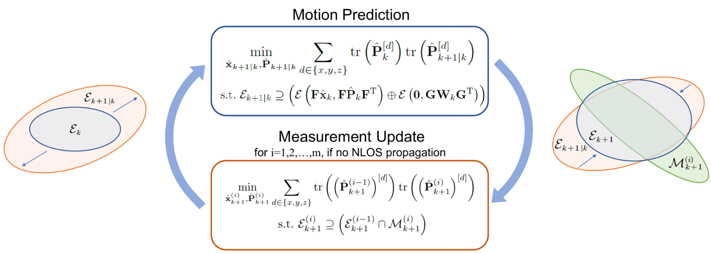

# [RA-L'25] Safety-Critical Ultra-Wideband 3D Localization With Set-Membership Uncertainty Representation

Paper Link: https://ieeexplore.ieee.org/document/11081890/

## 1. System Overview



## 2. Prerequisites

- Eigen3
- G2O ([compatible version](https://github.com/RainerKuemmerle/g2o/tree/9b41a4ea5ade8e1250b9c1b279f3a9c098811b5a))


## 3. Build
```
cd your_ros_ws
mkdir src
cd src
git clone https://github.com/Zhu-YQ/DB-SMF-UWB.git
cd ..
catkin_make
```


## 4. Run
```
source devel/setup.bash
roslaunch db_smf_uwb run_sim.launch
```


## 5. Citation
```
@ARTICLE{11081890,
  author={Zhou, Bo and Zhu, Yueqi and Rui, Chufan and Luo, Jiasheng and Pan, Yan},
  journal={IEEE Robotics and Automation Letters}, 
  title={Safety-Critical Ultra-Wideband 3D Localization With Set-Membership Uncertainty Representation}, 
  year={2025},
  volume={10},
  number={9},
  pages={8826-8833},
  doi={10.1109/LRA.2025.3589806}}
```


## Errata

In Lemma 2, the $\delta$ part in Equation (38) should be

$$
\delta = \left(1 - \mathbf{e}^{\mathrm{T}}\mathbf{S}^{-1}\mathbf{e}\right)/(1 - \lambda)
$$

In Theorem 2, the Equation (44) should be

$$
\delta_{k+1}^{(i)}(\lambda_{k+1}^{(i)})
= \left(1 - (e_{k+1}^{(i)})^2(S_{k+1}^{(i)}(\lambda_{k+1}^{(i)}))^{-1}\right)
  / \left(1 - \lambda_{k+1}^{(i)}\right)
$$

